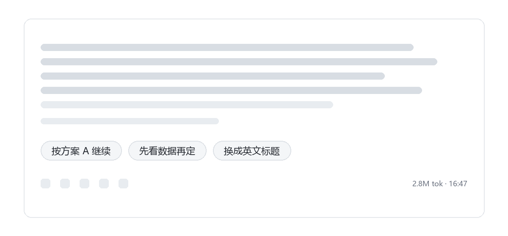

<div align="center">
  

# dsh-next-reply-chips

English | [**简体中文**](README.md)


`v0.6.1` · DSH `0.2.2-rc.x` · Desktop / Web

**Three next steps you can click, under every answer.**

The suggestions come from the reply itself — **no extra model call** — and a click either sends one immediately or fills the composer for you to edit.

<picture>
  <source media="(prefers-color-scheme: dark)" srcset="preview-dark.png">
  
</picture>

</div>

---

## 💡 What you get

The pills are generated by the model from that turn's answer. Typical shapes:

| When the answer… | You will likely see |
| --- | --- |
| offers two options | "Go with plan A" · "Switch to plan B" |
| dumps a pile of data | "Export the table as CSV" · "Recompute at 1550 nm" |
| stops for your decision | "Lock this in" · "Hold on, I want to check" |
| finishes without a next step | "Run the tests" · "Commit the changes" |

## ✨ Features

- After each completed turn, up to three pills appear **above** that turn's action row.
- Click behaviour is switchable: **send immediately** (default), or **fill the composer** for you to edit.
- Suggestions ship inside the reply you already paid for: **no added latency, no added cost per turn**.
- Delegated (sub-)agent sessions show no pills and receive no format instruction.
- Colours follow the DSH light/dark theme; chips are disabled while a session is running.
- No dependencies, no build step; install and remove are one `dsh plugin` command each.

## 📦 Install

From GitHub (recommended):

```powershell
dsh plugin --profile desktop add "github:Charlieeeo/dsh-next-reply-chips"
```

Or use **Settings → Plugins → Add plugin** and paste the same `github:Charlieeeo/dsh-next-reply-chips`.

From npm (pinned version, and storefronts can show download counts):

```powershell
dsh plugin --profile desktop add dsh-next-reply-chips
```

From a local checkout:

```powershell
dsh plugin --profile desktop add "E:\path\to\dsh-next-reply-chips"
```

Confirm it is enabled under **Settings → Plugins**. A **Host half** change needs a DSH restart; a **browser half** change needs only a page refresh.

Uninstall:

```powershell
dsh plugin --profile desktop remove dsh-next-reply-chips
```

## 🖱️ Usage

Nothing to configure: pills appear under the next completed answer.

Switch the click behaviour under **Settings → Next-reply chips**:

| Option | What a click does |
| --- | --- |
| **Send immediately** (default) | Goes out as your next message at once |
| **Fill the composer** | Lands in the composer; you edit and send it yourself |

To turn it off entirely: **Settings → Plugins → dsh-next-reply-chips** and switch it off. That removes the pills, the settings page, the fence hider **and** the system-prompt section together, leaving no stale state.

## ⚙️ Configuration

The only state is one boolean, at `~/.dsh/next-reply-chips.json`:

```json
{ "directSend": false }
```

Builds before 0.6 wrote it beside the package; that value is still read so an existing choice survives.

## 🧠 Design decisions

Everything below was learned by hitting it, not by reasoning about it up front.

### Why `turn` is folded to a number first

`turnTail`'s owner prop is declared `turn: TurnLocation` — **an object, not a number**. The first version compared it directly against `node.location.turn`, so a number could never equal an object, every match failed, and the UI showed **nothing at all**, silently, with no error.

`turnOf()` now folds `3` / `{turn:3}` / `{kind:'turn',turn:3}` / `{turn:{turn:3}}` to a number before comparing, with a fallback that only accepts the closing answer when nothing can be folded.

### Why assistant messages are read by walking the value

A user message carries `data.content` blocks, but **an assistant step does not guarantee that shape** — it may be a flat `text` or pre-rendered markdown. Reading the assistant node with the user-message shape returned an empty string, so the marker was never found.

`textOf()` now tries the known shapes (`content[].text`, `data.text`, `data.markdown`) first, and only then walks the value while skipping structural keys — otherwise `type: "text"` itself leaks into the options.

### Why the preference is not stored beside the package

`dsh plugin add github:...` installs into `node_modules`. Writing `config.json` there means an upgrade discards it, and some environments refuse the write.

It now lives at `~/.dsh/next-reply-chips.json`. `localStorage` was rejected because the Web GUI origin carries a port that changes on every launch (observed `:52778` → `:21537` → `:32235`), which silently resets browser-scoped values.

### Why there are zero dependencies

- A plugin `Config` form needs `@deepseek-ai/schemastery`, and a `link:`-installed package resolves bare imports from **its own** directory rather than the profile's `node_modules` — the form simply would not load for local installs.
- Declaring official `@deepseek-ai/*` `peerDependencies` brings a version trap: a range without a prerelease-tagged comparator on the target `major.minor.patch` tuple silently excludes prerelease builds, and an unmet peer **blocks installation**.

So the preference is a plain JSON file and the settings surface is a `settings.section` page. Slightly more code; installable from any path.

### Why the tests no longer touch the real config

An earlier suite read and wrote the package's `config.json`, and one run deleted the preference a user had saved. The suite now points `DSH_NRC_CONFIG_FILE` / `DSH_NRC_LEGACY_CONFIG_FILE` at scratch paths and never touches the real file.

## 🔒 Data and privacy

- **No network access.** The plugin makes no external request.
- **No auxiliary model call.** Nothing is sent anywhere; no extra request per turn.
- The only round-trip is a **same-origin** `GET/POST /plugins/dsh-next-reply-chips/config`, used solely for that one boolean.
- The only file written is `~/.dsh/next-reply-chips.json`.
- No telemetry.

## 🧩 Compatibility

| Item | Value |
| --- | --- |
| Verified against | DSH `0.2.2-rc.5` |
| Slots used | `conversation.chat.turnTail`, `conversation.chat.markdown.fence`, `settings.section` |
| If a slot is missing | That cell does not render; everything else keeps working |
| Dependencies / peers / private | `0` / `0` / `false` |

## ⚠️ Known limitations

- Relies on the model following the format; **a turn that does not follow it shows no pills** — no error, no gap. Some plugins spend an extra model call per turn to be format-independent, at the cost of latency and money every turn; this one took the other side.
- A ```` ```suggest ```` block pasted by hand into a user message is swallowed by the same layer.

## 🛠️ Development

```powershell
node test/smoke.mjs
```

<details>
<summary><b>What the 39 checks cover</b></summary>

| Group | Coverage |
| --- | --- |
| Host half | injects `systemPrompt`; registers exactly one section; template carries the fence marker |
| Delegated agents | the root agent keeps the instruction, a child gets an empty string |
| Preference route | path and `kind`; GET default; POST persists and reads back; non-boolean 400 without touching the file; unsupported method 405 |
| Legacy migration | a value written beside the package is still read |
| Registration | exports `inject=['slots']`; `turnTail` at order 60; `settings.section` at order 55 with its Chinese label; the `suggest` hoc layer exists and returns `null` |
| Parsing | three options; marker split across blocks; no marker returns `null`; turn scoping; truncation past three; duplicates and blanks dropped; `{turn:{turn}}` shape; JSON-array salvage; quote and bullet peeling; whitespace collapse; case-insensitive de-duplication; 80-character cap |
| Interaction | send mode calls `setDraft` + `submit`; draft mode calls only `setDraft`; the tooltip explains draft mode; disabled while running and inert on click; a missing `inputActions` does not throw |
| Robustness | a malformed snapshot returns `null`; the suite owns scratch paths and leaves nothing behind |

</details>

Debugging a missing row: run `window.__NRC_DIAG__ = true` in the browser console and reload. The newest answer then prints a one-line shape report (`turn`, `order` length, whether `nodes` is a map, trailing node kinds).

## 📜 License

[MIT](LICENSE)
