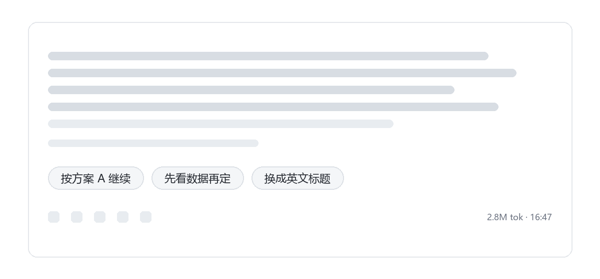

<div align="center">
  

# dsh-next-reply-chips

**简体中文** | [English](README.en.md)


`v0.6.1` · DSH `0.2.2-rc.x` · 桌面 / Web

**每条回答下方，三个可以直接点的下一步。**

建议由主回复自身给出，**不额外调用模型**；点一下可以直接发出，也可以只填进输入框等你确认。

<picture>
  <source media="(prefers-color-scheme: dark)" srcset="preview-dark.png">
  
</picture>

</div>

---

## 💡 你能拿它做什么

药丸内容由模型按当轮回答生成，下面是它通常长什么样：

| 当回答是这样的 | 你很可能看到 |
|---|---|
| 给了两个方案 | 「按方案 A 继续」「换成方案 B」 |
| 摆了一堆数据 | 「先把表导成 CSV」「按 1550 nm 重算」 |
| 停在需要你拍板的地方 | 「就按这个定」「先不动，我要复核」 |
| 做完了但没说下一步 | 「跑一下测试」「把改动提交」 |

## ✨ 功能

- 每轮回答结束后，在本轮动作行**上方**显示最多 3 个药丸按钮。
- 点击行为可切换：**直接发送**（默认），或**只填入输入框**、你改完再自己发。
- 建议随主回复一起产出，**每轮零附加延迟、零附加费用**。
- 代理（子）会话不显示药丸，也不会被注入格式指令。
- 颜色跟随 DSH 深浅主题；会话进行中时按钮置灰。
- 无依赖、无构建步骤；装与卸都是 `dsh plugin` 一条命令。

## 📦 安装

从 GitHub（推荐）：

```powershell
dsh plugin --profile desktop add "github:Charlieeeo/dsh-next-reply-chips"
```

或在 **设置 → 插件 → 添加插件** 里粘贴同一串 `github:Charlieeeo/dsh-next-reply-chips`。

从 npm（版本固定，市场能显示下载量）：

```powershell
dsh plugin --profile desktop add dsh-next-reply-chips
```

从本地目录：

```powershell
dsh plugin --profile desktop add "E:\path\to\dsh-next-reply-chips"
```

装完在 **设置 → 插件** 确认已启用。**主机半**改动需要重启 DSH；**浏览器半**改动只需刷新页面。

卸载：

```powershell
dsh plugin --profile desktop remove dsh-next-reply-chips
```

## 🖱️ 使用

装好后无需配置：下一轮回答结束，药丸就出现在回答下方。

点击行为在 **设置 → 下一步建议** 里切换：

| 选项 | 点击后 |
| --- | --- |
| **直接发送**（默认） | 立刻作为你的下一条消息发出 |
| **填入输入框，待我确认** | 只填进输入框，你可以改完再自己发 |

想彻底关掉：**设置 → 插件 → dsh-next-reply-chips** 关闭开关。这会同时移除药丸、设置页、代码块隐藏层和系统提示指令，不会留下脏状态。

## ⚙️ 配置

唯一的状态是一个布尔值，存在 `~/.dsh/next-reply-chips.json`：

```json
{ "directSend": false }
```

早于 0.6 的版本把它写在包目录，读取时仍会兼容并沿用其中的值。

## 🧠 设计取舍

这一节记录的每一条，都是**实测撞出来之后才敢写**的，不是设计时的猜测。

### 为什么 `turn` 要先折成数字

`turnTail` 的 owner prop 声明是 `turn: TurnLocation`——**是对象，不是数字**。第一版直接拿它与 `node.location.turn` 比较，数字永远不等于对象，于是每次匹配都失败，界面**静默**没有药丸、也不报错。

现在 `turnOf()` 会把 `3` / `{turn:3}` / `{kind:'turn',turn:3}` / `{turn:{turn:3}}` 全部折成数字再比；折不出来时还有一个兜底：只认「收尾回答」，避免旧轮次重复显示。

### 为什么助手消息要按"猜不到就遍历"来读

用户消息的载荷是 `data.content` 的块数组，但**助手消息不保证是这个形状**——可能是扁平 `text`，也可能是渲染好的 markdown。第一版按用户消息的结构去读助手节点，取到空字符串，于是永远找不到标记。

现在先试已知形状（`content[].text` / `data.text` / `data.markdown`），都落空才遍历整个值，并跳过 `type`/`kind`/`role` 这类结构键——否则 `type: "text"` 这个值会被当成正文混进选项里。

### 为什么偏好不写在包目录

`dsh plugin add github:...` 会把包装进 `node_modules`。第一版把 `config.json` 写在包目录，那样一旦升级就会被覆盖，某些环境还可能只读。

现在落在 `~/.dsh/next-reply-chips.json`。没用 `localStorage`，是因为 Web GUI 的 origin 带端口、且这个端口在每次启动时都会变（实测见过 `:52778` → `:21537` → `:32235`），浏览器域内的值会莫名复位。

### 为什么坚持零依赖

- 插件 `Config` 表单需要 `@deepseek-ai/schemastery`，而 `link:` 安装的包是从**自己目录**解析裸模块，不是 profile 的 `node_modules`——表单在本地安装时根本加载不出来。
- 声明官方 `@deepseek-ai/*` 的 `peerDependencies` 有版本陷阱：范围里若没有与目标 `major.minor.patch` 同元组、且自带预发布标签的比较符，预发布版会被静默排除；而 peer 不满足会**直接阻断安装**。

所以偏好是一个普通 JSON 文件，设置面是一个 `settings.section` 页面。代价是多写了点代码，收益是从任何路径都能装。

### 为什么测试不能用真实配置文件

早期的测试会读写包目录里的 `config.json`，某次跑完直接把使用者存的偏好删了。现在测试通过 `DSH_NRC_CONFIG_FILE` / `DSH_NRC_LEGACY_CONFIG_FILE` 指向临时路径，**完全不碰**真实文件。

## 🔒 数据与隐私

- **不联网**。插件不发起任何外部请求。
- **不额外调用模型**。没有辅助请求，没有把会话内容发到别处。
- 唯一的网络往返是**同源**的 `GET/POST /plugins/dsh-next-reply-chips/config`，只用于读写上面那个布尔值。
- 唯一的落盘文件是 `~/.dsh/next-reply-chips.json`。
- 不采集任何遥测。

## 🧩 兼容性

| 项 | 说明 |
| --- | --- |
| 实测内核 | DSH `0.2.2-rc.5` |
| 依赖槽位 | `conversation.chat.turnTail`、`conversation.chat.markdown.fence`、`settings.section` |
| 槽位缺失时 | 那一格不渲染，其余功能照常 |
| 依赖 / peer / private | `0` / `0` / `false` |

## ⚠️ 已知限制

- 依赖模型遵守格式；**不遵守格式的那一轮没有药丸**——不报错、不留空行。有插件选择"每轮额外调一次模型"来换取格式无关，代价是每轮的延迟与费用；本项目选了前者。
- 用户消息里若手动粘贴 ```` ```suggest ```` 代码块，也会被同一个隐藏层吞掉。

## 🛠️ 开发

```powershell
node test/smoke.mjs
```

<details>
<summary><b>39 项测试覆盖了什么</b></summary>

| 分组 | 覆盖 |
| --- | --- |
| 主机段 | 注入 `systemPrompt`；只注册一条 section；模板含代码块标记 |
| 代理会话 | 根代理保留指令、子代理返回空串 |
| 偏好路由 | 注册路径与 `kind`；GET 默认值；POST 落盘并可回读；非布尔载荷 400 且不改文件；不支持的 405 |
| 旧值迁移 | 旧位置的值仍能被读到 |
| 注册 | 导出 `inject=['slots']`；`turnTail` 序位 60；`settings.section` 序位 55 与中文标题；`suggest` hoc 层存在且返回 `null` |
| 解析 | 三选项；跨块标记；无标记返回 `null`；轮次隔离；超过 3 项截断；重复与空项丢弃；`{turn:{turn}}` 形态；JSON 数组兜底；剥引号与列表符；空白折叠；不分大小写去重；80 字截断 |
| 交互 | 发送模式调用 `setDraft` + `submit`；草稿模式只 `setDraft`；悬浮提示在草稿模式带说明；运行中禁用且点击无效；缺 `inputActions` 不抛错 |
| 健壮性 | 畸形快照返回 `null`；插件自身读取临时文件、不留残留 |

</details>

调试"药丸没出现"：在浏览器控制台执行 `window.__NRC_DIAG__ = true` 并刷新，最新一条回答下方会打印一行形状诊断（`turn`、`order` 长度、`nodes` 是否 map、尾部节点种类）。

## 📜 许可

[MIT](LICENSE)
